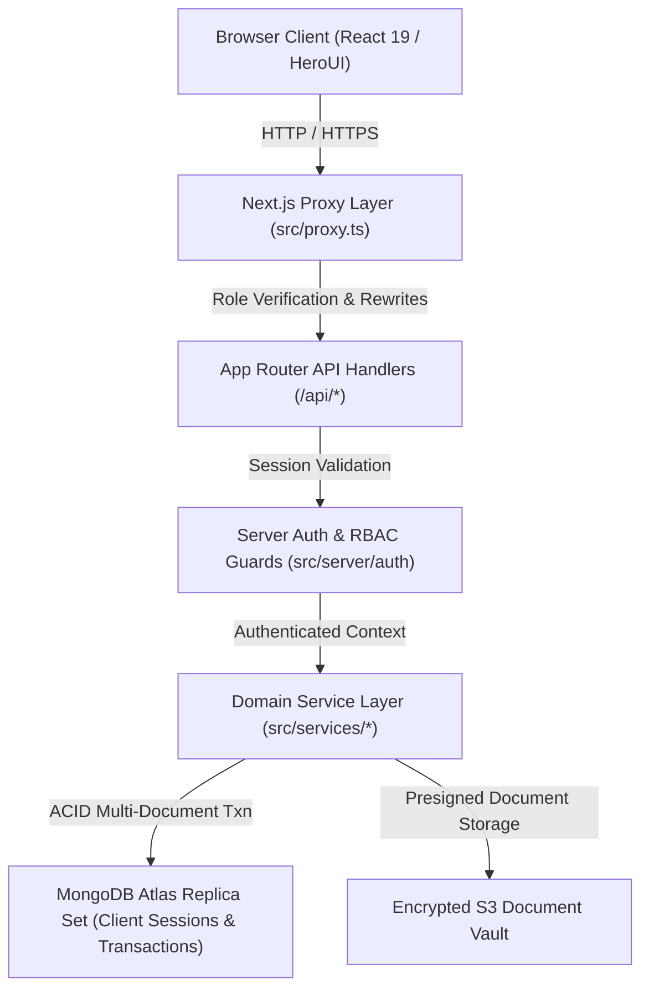
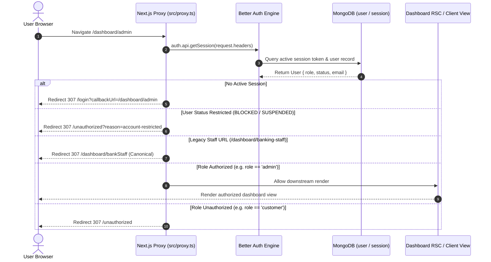
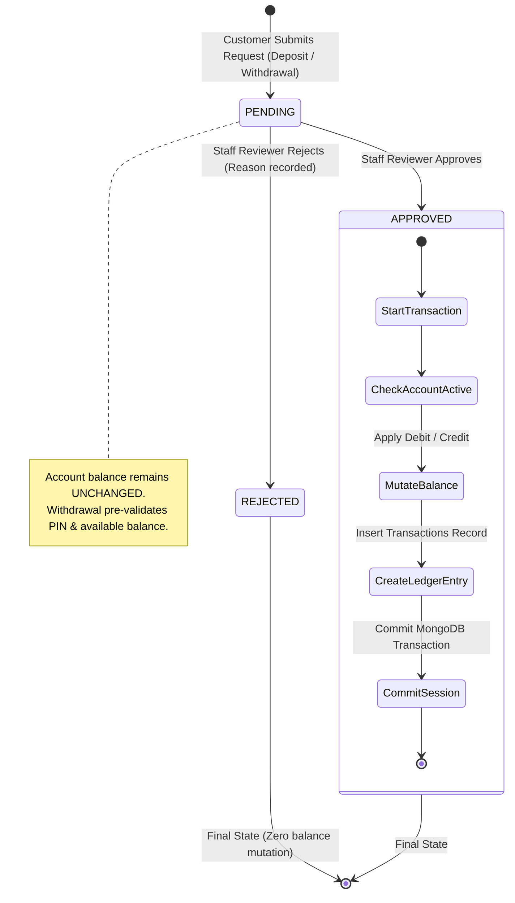
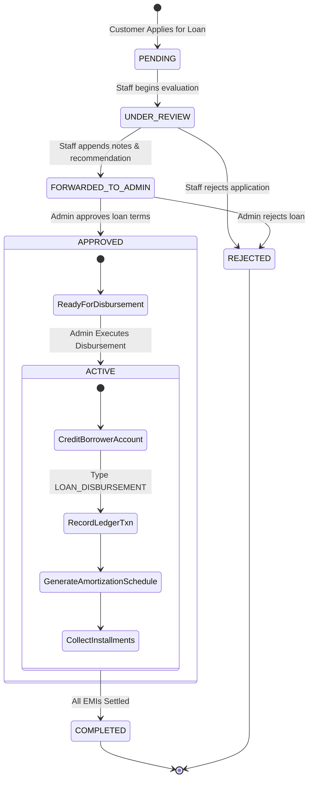
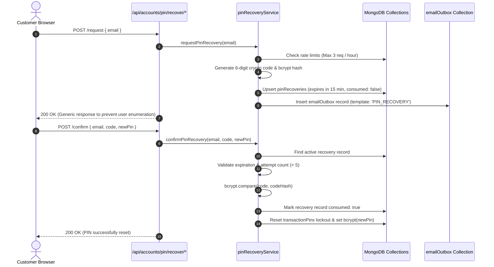
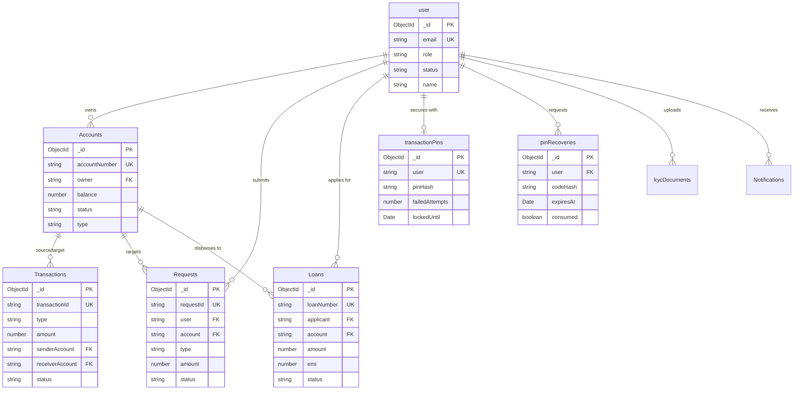

# Trustora Bank — Enterprise Digital Banking Platform

[](https://nextjs.org/)
[](https://react.dev/)
[](https://www.typescriptlang.org/)
[](https://www.mongodb.com/)
[](https://tailwindcss.com/)
[](https://heroui.com/)
[](https://www.better-auth.com/)

> **Trustora Bank** is a modern, high-assurance digital banking solution delivering end-to-end multi-role financial workflows. Built with Next.js 16 App Router, React 19, TypeScript, and MongoDB Atlas, Trustora Bank enforces strict server-side Role-Based Access Control (RBAC), atomic multi-document transactional integrity, dual-phase financial request approval, encrypted KYC processing, cryptographic transaction PIN security with email outbox recovery, and automated statement generation.

---

## Table of Contents

1. [Project Overview](#1-project-overview)
2. [Technology Stack](#2-technology-stack)
3. [System Architecture](#3-system-architecture)
   - [High-Level Architectural Model](#high-level-architectural-model)
   - [Authentication & RBAC Routing Flow](#authentication--rbac-routing-flow)
   - [Financial Request & Approval Lifecycle](#financial-request--approval-lifecycle)
   - [Loan Lifecycle & Disbursement Flow](#loan-lifecycle--disbursement-flow)
   - [Cryptographic PIN Recovery Flow](#cryptographic-pin-recovery-flow)
4. [User Roles & Authorization Matrix](#4-user-roles--authorization-matrix)
5. [Comprehensive Feature Documentation](#5-comprehensive-feature-documentation)
   - [Authentication & Identity Management](#authentication--identity-management)
   - [Customer Banking Operations](#customer-banking-operations)
   - [Banking Staff Operations](#banking-staff-operations)
   - [System Administration & Governance](#system-administration--governance)
   - [Statement Generation & PDF Export](#statement-generation--pdf-export)
6. [Database Architecture & Data Models](#6-database-architecture--data-models)
   - [Critical Schema Distinction: Better Auth vs. Banking Ledger](#critical-schema-distinction-better-auth-vs-banking-ledger)
   - [Collection Catalog & Schemas](#collection-catalog--schemas)
   - [Entity-Relationship Diagram](#entity-relationship-diagram)
7. [Complete REST API Reference](#7-complete-rest-api-reference)
   - [Authentication & Profile Endpoints](#authentication--profile-endpoints)
   - [Customer Account & PIN Endpoints](#customer-account--pin-endpoints)
   - [Transaction & Ledger Endpoints](#transaction--ledger-endpoints)
   - [Deposit & Withdrawal Request Endpoints](#deposit--withdrawal-request-endpoints)
   - [Loan Origination & Servicing Endpoints](#loan-origination--servicing-endpoints)
   - [Banking Staff Endpoints](#banking-staff-endpoints)
   - [System Administration Endpoints](#system-administration-endpoints)
   - [KYC & Identity Verification Endpoints](#kyc--identity-verification-endpoints)
   - [In-App Notifications Endpoints](#in-app-notifications-endpoints)
8. [Financial Workflows & Ledger Integrity](#8-financial-workflows--ledger-integrity)
   - [Deposit Request Flow](#deposit-request-flow)
   - [Withdrawal Request Flow](#withdrawal-request-flow)
   - [Direct Internal Account Transfers](#direct-internal-account-transfers)
   - [Loan Origination, Review & Disbursement](#loan-origination-review--disbursement)
9. [Security Architecture & Defensive Engineering](#9-security-architecture--defensive-engineering)
10. [Project Structure](#10-project-structure)
11. [Environment Configuration & Local Setup](#11-environment-configuration--local-setup)
12. [Testing, QA & Test Harness](#12-testing-qa--test-harness)
13. [Deployment Guide](#13-deployment-guide)
14. [Known Limitations & Future Roadmap](#14-known-limitations--future-roadmap)
15. [Documentation & Contribution Guidelines](#15-documentation--contribution-guidelines)

---

## 1. Project Overview

### Vision & Problem Statement
Traditional retail banking portals frequently suffer from fragmented architectures, vulnerable client-side validations, lack of auditability, and brittle ledger processing. Trustora Bank addresses these operational vulnerabilities by delivering an enterprise-ready banking application designed with defensive programming principles:
- **Ledger Invariance:** Every monetary movement requires multi-document atomic sessions with verified pre-conditions and post-conditions.
- **Strict Role Isolation:** Customer, Banking Staff, and Administrator portals operate with distinct privilege boundaries enforced at the proxy/middleware and route handler levels.
- **Auditable Lifecycle Management:** Financial requests, KYC documents, and loan applications adhere to strict finite state machines (FSM), preventing double-spending and unapproved balance mutations.

### Implemented vs. Non-Implemented Boundaries
| Subsystem | Implemented in Trustora Bank | Deliberate System Boundary |
| :--- | :--- | :--- |
| **Authentication** | Email/Password, Google OAuth, Better Auth sessions, MongoDB session adapter. | Third-party SAML/OIDC enterprise federation. |
| **Authorization** | Server-side RBAC (`customer`, `banking-staff`, `admin`), account status locks (`SUSPENDED`, `BLOCKED`, `DEACTIVATED`). | Multi-organization multi-tenancy. |
| **Banking Ledger** | `Accounts`, `Transactions`, `Requests`, `Loans`, double-entry balance debits/credits, balance snapshots. | External card processor gateway (Visa/Mastercard interchange). |
| **Transaction Security**| Bcrypt-hashed 6-digit PINs, lockout limits, 6-digit recovery codes via `emailOutbox`. | Hardware Security Modules (HSM) / FIDO2 WebAuthn keys. |
| **Documents & KYC** | Encrypted document storage, masked ID numbers, staff verification queues, legal hold. | External credit bureau automated pulling (Equifax/Experian). |
| **Reporting & Export**| RFC-compliant CSV export, native multi-page vector A4 PDF statement generation via `pdf-lib`. | Direct SWIFT MT940 / CAMT.053 core banking feeds. |

---

## 2. Technology Stack

### Core Framework & Runtime
- **Next.js `16.4.6`**: App Router architecture, React Server Components (RSC), Client Components, route handlers, route segment configs.
- **React `19.3.0` & React-DOM `19.3.0`**: React 19 concurrent features, Actions, and unified form lifecycle.
- **TypeScript `^5.9.3`**: Strict mode type checking across models, services, and client components.
- **Node.js**: LTS `^20.x` or `>= 18.17.0`.

### UI & Styling System
- **Tailwind CSS `4.3.3`** & `@tailwindcss/postcss ^4.3.3`: Utility-first CSS framework with modern CSS variables.
- **HeroUI `@heroui/react ^3.2.7` & `@heroui/styles ^3.2.7`**: Accessible, modular UI component library.
- **Framer Motion (`motion ^14.14.0`)**: Smooth dashboard animations, transitions, and collapsible panels.
- **Lucide React (`lucide-react ^1.77.0`)**: High-legibility banking and operational iconography.
- **Recharts `^3.11.0`**: Responsive SVG data visualization for balances, transaction metrics, and loan distributions.
- **React Hot Toast `^2.6.1`**: Toast notification system for user-facing actions.

### Data Layer & Storage
- **MongoDB Node.js Driver `^7.9.1`**: Native database driver configured with connection pooling, replica set transaction sessions, and schema indexing.
- **MongoDB Atlas**: Managed replica set supporting ACID multi-document transactions.
- **AWS SDK (`@aws-sdk/client-s3 ^3.1175.0`, `@aws-sdk/s3-request-presigner ^3.1175.0`, `@aws-sdk/s3-presigned-post ^3.1175.0`)**: S3-compatible document storage integration for KYC attachments and avatar assets.
- **Sharp `^0.35.5`**: Server-side image processing and avatar optimization.

### Identity & Security
- **Better Auth `^1.7.27`** & `@better-auth/mongo-adapter ^1.7.27`: Multi-factor capable authentication framework managing sessions, users, and credentials.
- **Bcrypt.js (`bcryptjs ^3.0.3`, `@types/bcryptjs ^2.4.6`)**: One-way salted cryptographic hashing for transaction PINs and emergency recovery tokens.
- **PDF-Lib `^1.17.1`**: Deterministic client/server PDF generation with vector graphics and layout control.

---

## 3. System Architecture

Trustora Bank follows a modular, layered clean architecture. UI components delegate to typed client services, which interface with Next.js App Router API endpoints guarded by authorization utilities. The server layer interacts with business logic services that enforce transactional consistency on MongoDB.

### High-Level Architectural Model



---

### Authentication & RBAC Routing Flow



---

### Financial Request & Approval Lifecycle



---

### Loan Lifecycle & Disbursement Flow



---

### Cryptographic PIN Recovery Flow



---

## 4. User Roles & Authorization Matrix

Trustora Bank enforces a three-tiered hierarchical Role-Based Access Control (RBAC) model augmented by account-level lifecycle statuses.

### Role Definitions
1. **`customer`**: Standard banking client. Granted access strictly to their own accounts, transaction history, loan applications, and profile configurations. Cannot access administrative routes or review queues.
2. **`banking-staff`**: Operational personnel. Authorized to inspect pending customer requests, verify KYC submissions, flag suspicious ledger entries, append loan assessment notes, and recommend loans to administrators. Cannot approve staff promotions, alter global bank settings, or disburse loans.
3. **`admin`**: System administrator. Possesses supervisory access across all customer and staff entities, final loan approvals, atomic disbursements, staff status promotions/demotions, KYC legal holds, and system-wide aggregations. Guarded by the **Last-Admin Protection Protocol**.

### Route & Action Authorization Matrix

| Route / Capability | Customer | Banking Staff | Administrator | Enforcement Mechanism |
| :--- | :---: | :---: | :---: | :--- |
| **`/dashboard/customer/*`** | <span style="color:green">✔ Full</span> | <span style="color:orange">⚠ View</span> | <span style="color:green">✔ Full</span> | Proxy + `requireAuth()` |
| **`/dashboard/bankStaff/*`** | <span style="color:red">✖ Denied</span> | <span style="color:green">✔ Full</span> | <span style="color:green">✔ Full</span> | Proxy + `requireStaffOrAdmin()` |
| **`/dashboard/admin/*`** | <span style="color:red">✖ Denied</span> | <span style="color:red">✖ Denied</span> | <span style="color:green">✔ Full</span> | Proxy + `requireAdmin()` |
| **Create Deposit / Withdrawal** | <span style="color:green">✔ Self</span> | <span style="color:red">✖ Denied</span> | <span style="color:red">✖ Denied</span> | `requireAuth()`, validates account owner |
| **Review Deposit / Withdrawal** | <span style="color:red">✖ Denied</span> | <span style="color:green">✔ Allowed</span> | <span style="color:green">✔ Allowed</span> | `requireStaffOrAdmin()`, anti-self-review |
| **Apply for Personal Loan** | <span style="color:green">✔ Self</span> | <span style="color:red">✖ Denied</span> | <span style="color:red">✖ Denied</span> | `requireAuth()`, applicant email bound |
| **Recommend / Note Loan** | <span style="color:red">✖ Denied</span> | <span style="color:green">✔ Allowed</span> | <span style="color:green">✔ Allowed</span> | `requireStaffOrAdmin()` |
| **Approve & Disburse Loan** | <span style="color:red">✖ Denied</span> | <span style="color:red">✖ Denied</span> | <span style="color:green">✔ Allowed</span> | `requireAdmin()` strictly |
| **Set / Recover PIN** | <span style="color:green">✔ Self</span> | <span style="color:red">✖ Denied</span> | <span style="color:red">✖ Denied</span> | `requireAuth()`, email matching |
| **Verify KYC Documents** | <span style="color:red">✖ Denied</span> | <span style="color:green">✔ Allowed</span> | <span style="color:green">✔ Allowed</span> | `requireStaffOrAdmin()` |
| **Place KYC Legal Hold** | <span style="color:red">✖ Denied</span> | <span style="color:red">✖ Denied</span> | <span style="color:green">✔ Allowed</span> | `requireAdmin()` strictly |
| **Promote Staff / Last-Admin** | <span style="color:red">✖ Denied</span> | <span style="color:red">✖ Denied</span> | <span style="color:green">✔ Guarded</span> | `requireAdmin()` + `adminGuard` lock |

---

## 5. Comprehensive Feature Documentation

### Authentication & Identity Management
- **Better Auth Integration:** Session cookies with HTTP-only, secure, and same-site flags.
- **Account Status Enforcement:** Users marked as `SUSPENDED`, `BLOCKED`, `DEACTIVATED`, or `INACTIVE` are intercepted by `src/proxy.ts` and redirected to `/unauthorized?reason=account-restricted`.
- **Profile Customization:** Profile editing with persistent user preferences (`currency`, `twoFactorEnabled`, `notificationsEnabled`) and avatar upload/removal pipeline backed by S3 presigned URLs.

### Customer Banking Operations
- **Multi-Account Overview:** Display of active accounts (`SAVINGS`, `CURRENT`, `BUSINESS`) with real-time balance calculations, masked account numbers, and currency localization.
- **Request-Based Deposits:** Customers choose their account, specify an amount and payment method (e.g. `BANK_TRANSFER`, `CASH`, `CHEQUE`), providing reference metadata.
- **PIN-Secured Withdrawals:** Submitting a withdrawal requires client-side PIN entry and server-side verification against bcrypt hashes. Accounts are validated for sufficient available funds and withdrawal limits.
- **Peer-to-Peer Internal Transfers:** Direct atomic transfer between bank accounts. Enforces debit from sender, credit to receiver, ledger creation, and automatic fee deduction.
- **Loan Origination:** Intuitive loan application wizard supporting tenure selection, interest rate calculations, dynamic EMI amortization previews, and document linkage.
- **Transaction History & Filter Bar:** Paginated ledger browser with real-time filtering by account, transaction type (`DEPOSIT`, `WITHDRAWAL`, `TRANSFER`, `FEE`, `LOAN_DISBURSEMENT`), and custom date ranges.

### Banking Staff Operations
- **Consolidated Operational Metrics:** Live operational cockpit (`GET /api/staff/metrics`) tracking pending review queues, unverified KYC documents, flagged transactions, and daily throughput.
- **Financial Request Review Queue:** Staff review deposit and withdrawal submissions with complete customer metadata, applying approvals or providing explicit rejection justifications.
- **Loan Evaluation & Forwarding:** Dedicated interface to inspect customer debt-to-income indicators, attach review notes, and transition eligible loans to `FORWARDED_TO_ADMIN`.
- **KYC Document Queue:** Review uploaded customer identity documents, inspect decrypted fields securely, and update statuses to `VERIFIED` or `REJECTED`.
- **Transaction Flagging:** Ability to place compliance flags on anomalous transactions for audit review.

### System Administration & Governance
- **Executive Analytics Dashboard:** Comprehensive platform KPIs powered by MongoDB aggregations (`GET /api/admin/analytics`), tracking total deposits, withdrawals, platform liquidity, loan status breakdowns, and 30-day volume trends.
- **Account Governance & Limits:** Modify customer account limits (daily withdrawal ceiling, maximum single transaction, minimum required balance) and toggle account statuses (`ACTIVE`, `FROZEN`, `CLOSED`).
- **Staff Directory & Role Promotion:** Comprehensive employee roster. Admins can update staff permissions, deactivate accounts, or promote staff members.
- **Last-Admin Protection Protocol:** Atomic check ensuring that demoting or deactivating an admin is rejected if fewer than 2 active administrators exist across the system.
- **Legal Hold Controls:** Enforce non-expiring legal holds on customer identity documents during investigations.

### Statement Generation & PDF Export
- **RFC-4180 Compliant CSV Export:** Generates streaming CSV statements with formatted headers, standard delimiters, and sanitized numeric fields.
- **Vector PDF Statements via `pdf-lib`:** Multi-page A4 PDF engine generating professional bank statements. Features:
  - Trustora Bank header, security badges, and dynamic generation timestamps.
  - Formatted account summary, account holder details, and opening/closing balances.
  - Alternating row styling, automatic page wrapping, and localized BDT monetary units.

---

## 6. Database Architecture & Data Models

Trustora Bank utilizes MongoDB Atlas with explicit multi-document ACID transactions via replica sets.

### Critical Schema Distinction: Better Auth vs. Banking Ledger

> [!IMPORTANT]
> **Schema Separation:** The database strictly separates authentication internals from banking business logic.
> - **`account`**: Internal authentication accounts managed by Better Auth (OAuth links, password hashes, credentials).
> - **`Accounts` (`COLLECTIONS.ACCOUNTS`)**: Core banking ledger accounts holding monetary balances, account numbers, and statuses.

### Collection Catalog & Schemas

#### 1. `user` (Application Users)
```typescript
interface User {
  _id: ObjectId;
  name: string;
  email: string;
  role: "admin" | "banking-staff" | "customer";
  status: "ACTIVE" | "INACTIVE" | "SUSPENDED" | "BLOCKED" | "DEACTIVATED";
  image?: string;
  phone?: string;
  address?: string;
  preferences?: {
    currency?: string;
    twoFactorEnabled?: boolean;
    notificationsEnabled?: boolean;
    darkMode?: boolean;
  };
  createdAt: Date;
  updatedAt: Date;
}
```

#### 2. `Accounts` (Banking Accounts)
```typescript
interface BankAccount {
  _id: ObjectId;
  accountNumber: string; // Unique index (e.g. "ACC-71829304")
  owner: string; // User email reference
  type: "SAVINGS" | "CURRENT" | "BUSINESS";
  balance: number; // Current cleared balance
  currency: string; // Defaults to "BDT"
  status: "ACTIVE" | "FROZEN" | "CLOSED";
  dailyLimit: number;
  monthlyLimit: number;
  minBalance: number;
  createdAt: Date;
  updatedAt: Date;
}
```

#### 3. `Transactions` (Double-Entry Banking Ledger)
```typescript
interface Transaction {
  _id: ObjectId;
  transactionId: string; // Unique index (e.g. "TXN-1740478000-XYZ")
  type: "DEPOSIT" | "WITHDRAWAL" | "TRANSFER" | "FEE" | "INTEREST" | "LOAN_DISBURSEMENT" | "LOAN_REPAYMENT";
  amount: number;
  fee: number;
  status: "COMPLETED" | "PENDING" | "FAILED" | "REVERSED";
  senderAccount?: string; // Account number
  receiverAccount?: string; // Account number
  senderBalanceAfter?: number;
  receiverBalanceAfter?: number;
  description: string;
  metadata?: Record<string, any>;
  createdAt: Date;
}
```

#### 4. `Requests` (Deposit & Withdrawal Requests)
```typescript
interface FinancialRequest {
  _id: ObjectId;
  requestId: string; // Unique index (e.g. "REQ-1740478000-ABC")
  user: string; // User email
  account: string; // Account number
  type: "DEPOSIT" | "WITHDRAWAL";
  amount: number;
  status: "PENDING" | "APPROVED" | "REJECTED";
  reviewedBy?: string; // Staff/Admin email
  reviewedAt?: Date;
  rejectionReason?: string;
  paymentMethod?: string;
  referenceNumber?: string;
  notes?: string;
  createdAt: Date;
  updatedAt: Date;
}
```

#### 5. `Loans` (Loan Applications & Servicing)
```typescript
interface Loan {
  _id: ObjectId;
  loanNumber: string; // Unique index (e.g. "LN-1740478000-DEF")
  applicant: string; // Customer email
  account: string; // Disbursement account number
  type: "PERSONAL" | "HOME" | "BUSINESS" | "EDUCATION";
  amount: number;
  durationMonths: number;
  interestRate: number;
  emi: number;
  status: "PENDING" | "UNDER_REVIEW" | "FORWARDED_TO_ADMIN" | "APPROVED" | "ACTIVE" | "REJECTED" | "COMPLETED";
  staffNotes?: Array<{
    author: string;
    note: string;
    createdAt: Date;
  }>;
  disbursedAt?: Date;
  disbursedBy?: string;
  repayments?: Array<{
    installmentNo: number;
    dueDate: Date;
    amount: number;
    paidAmount: number;
    status: "PENDING" | "PAID" | "OVERDUE";
    paidAt?: Date;
  }>;
  createdAt: Date;
  updatedAt: Date;
}
```

#### 6. `transactionPins` (Cryptographic PIN Store)
```typescript
interface TransactionPin {
  _id: ObjectId;
  user: string; // User email (Unique index)
  pinHash: string; // Bcrypt salted hash
  failedAttempts: number;
  lockedUntil?: Date;
  createdAt: Date;
  updatedAt: Date;
}
```

#### 7. `pinRecoveries` (Single-Use Recovery Codes)
```typescript
interface PinRecovery {
  _id: ObjectId;
  user: string; // User email
  codeHash: string; // Bcrypt hash of 6-digit recovery code
  expiresAt: Date; // TTL 15 minutes
  attempts: number; // Max 5 verification attempts
  consumed: boolean;
  createdAt: Date;
}
```

#### 8. `emailOutbox` (Transactional Email Dispatch)
```typescript
interface EmailOutbox {
  _id: ObjectId;
  recipientEmail: string;
  subject: string;
  template: "PIN_RECOVERY" | "TRANSACTION_ALERT" | "LOAN_STATUS_UPDATE";
  templateData: Record<string, any>;
  status: "PENDING" | "SENT" | "FAILED";
  attempts: number;
  createdAt: Date;
}
```

#### 9. Supporting Collections
- **`kycDocuments`**: Identity documents with AES-256 field encryption (`encryptedDocumentNumber`, `maskedDocumentNumber`, `legalHold`).
- **`auditLogs`**: Immutable operational trail (`action`, `performedBy`, `targetEntity`, `changes`, `ipAddress`).
- **`bankSettings`**: Global limits, interest rate schedules, and fee structures.
- **`Notifications`**: Real-time user alert records.
- **`adminGuard`**: Distributed concurrency lock preventing last-administrator demotion.

---

### Entity-Relationship Diagram



---

## 7. Complete REST API Reference

All API routes are located under `src/app/api/` and require valid session credentials unless otherwise specified.

### Authentication & Profile Endpoints

| Method | Path | Required Role | Description |
| :--- | :--- | :---: | :--- |
| `ALL` | `/api/auth/[...all]` | Public | Better Auth standard authentication router (sign-in, sign-up, sign-out, OAuth). |
| `GET` | `/api/auth/me` | Authenticated | Retrieves current user session and complete profile attributes. |
| `PATCH` | `/api/auth/me` | Authenticated | Updates personal information (phone, address) and user preferences. |
| `POST` | `/api/auth/me/avatar` | Authenticated | Uploads, replaces, or optimizes user avatar image. |
| `DELETE`| `/api/auth/me/avatar` | Authenticated | Removes current user avatar and resets to default initials. |

### Customer Account & PIN Endpoints

| Method | Path | Required Role | Description |
| :--- | :--- | :---: | :--- |
| `GET` | `/api/accounts` | Authenticated | Returns all bank accounts owned by the authenticated user. |
| `GET` | `/api/accounts/[accountNumber]` | Authenticated | Retrieves details for an owned account (or any account if Staff/Admin). |
| `GET` | `/api/accounts/pin/status` | Authenticated | Checks if the authenticated user has configured a transaction PIN and lockout status. |
| `POST` | `/api/accounts/pin/set` | Authenticated | Sets an initial 6-digit transaction PIN (bcrypt salted hash). |
| `POST` | `/api/accounts/pin/verify` | Authenticated | Verifies current PIN with 5-attempt brute-force protection and lockout timer. |
| `POST` | `/api/accounts/pin/recover/request`| Public / Auth | Generates 6-digit recovery code sent to `emailOutbox` (rate limited: 3/hour). |
| `POST` | `/api/accounts/pin/recover/confirm`| Public / Auth | Confirms recovery code, resets lockout, and sets new PIN. |

### Transaction & Ledger Endpoints

| Method | Path | Required Role | Description |
| :--- | :--- | :---: | :--- |
| `GET` | `/api/transactions` | Authenticated | Paginated query of transactions for owned accounts (or system-wide if Staff/Admin). Supports filters: `accountNumber`, `type`, `startDate`, `endDate`. |
| `GET` | `/api/transactions/[id]` | Authenticated | Retrieves single transaction detail by `transactionId`. |
| `POST` | `/api/transactions/transfer` | Authenticated | Executes atomic internal transfer between accounts. Requires PIN verification. |
| `POST` | `/api/transactions/fee` | Authenticated | Calculates dynamic transaction fees based on type and amount. |
| `GET` | `/api/transactions/statement` | Authenticated | Exports statement as RFC-4180 CSV (`format=csv`) or vector PDF (`format=pdf`). |

### Deposit & Withdrawal Request Endpoints

| Method | Path | Required Role | Description |
| :--- | :--- | :---: | :--- |
| `GET` | `/api/requests` | Authenticated | Lists requests for current user (or all system requests if Staff/Admin). Supports `status` and `type` filters. |
| `POST` | `/api/requests` | Authenticated | Submits a new deposit or withdrawal request. Withdrawals require verified PIN. |
| `GET` | `/api/requests/[id]` | Authenticated | Retrieves request details by ID. |
| `POST` | `/api/requests/[id]/review` | Staff / Admin | Reviews request (`APPROVED` or `REJECTED`). Executes atomic balance updates upon approval. Anti-self-review enforced. |

### Loan Origination & Servicing Endpoints

| Method | Path | Required Role | Description |
| :--- | :--- | :---: | :--- |
| `GET` | `/api/loans` | Authenticated | Lists loan applications for the applicant (or all applications if Staff/Admin). |
| `POST` | `/api/loans` | Authenticated | Submits a new loan application. Calculates amortization schedule and EMI. |
| `GET` | `/api/loans/[id]` | Authenticated | Retrieves detailed loan application by ID. |
| `POST` | `/api/loans/[id]/notes` | Staff / Admin | Appends operational assessment notes to a loan record. |
| `POST` | `/api/loans/[id]/forward` | Staff / Admin | Forwards evaluated loan to administrator (`FORWARDED_TO_ADMIN`). |
| `POST` | `/api/loans/[id]/review` | Staff / Admin | Approves or rejects loan application (Final approval restricted to Admin). |
| `POST` | `/api/loans/[id]/disburse` | Admin strictly | Atomically disburses approved loan funds into the borrower's account. |
| `GET` | `/api/loans/[id]/repayments` | Authenticated | Retrieves EMI repayment schedule and payment history. |
| `POST` | `/api/loans/[id]/repayments/[installmentNo]/pay` | Authenticated | Settles single EMI installment from borrower's account. |

### Banking Staff Endpoints

| Method | Path | Required Role | Description |
| :--- | :--- | :---: | :--- |
| `GET` | `/api/staff/metrics` | Staff / Admin | Returns aggregated operational KPIs: pending requests, unreviewed loans, unverified KYC, flagged transactions. |
| `GET` | `/api/staff/kyc` | Staff / Admin | Lists customer KYC document verification queue. |
| `GET` | `/api/staff/kyc/[id]` | Staff / Admin | Inspects customer KYC document with decrypted document number. |
| `POST` | `/api/staff/kyc/[id]/verify` | Staff / Admin | Approves or rejects customer KYC document submission. |
| `GET` | `/api/staff/transactions/flagged` | Staff / Admin | Retrieves transactions flagged for compliance review. |
| `POST` | `/api/staff/transactions/[id]/flag` | Staff / Admin | Flags suspicious transaction with audit notes. |
| `POST` | `/api/staff/transactions/[id]/review` | Staff / Admin | Clears compliance flag on reviewed transaction. |

### System Administration Endpoints

| Method | Path | Required Role | Description |
| :--- | :--- | :---: | :--- |
| `GET` | `/api/admin/analytics` | Admin strictly | Aggregated platform analytics: total balances, deposits, withdrawals, volume trends, and loan distributions. |
| `GET` | `/api/admin/customers` | Admin strictly | Lists all registered customers with account statuses and aggregated balances. |
| `GET` | `/api/admin/customers/[id]` | Admin strictly | Retrieves comprehensive customer profile, accounts, and audit history. |
| `PATCH`| `/api/admin/customers/[id]/status`| Admin strictly | Modifies customer account status (`ACTIVE`, `SUSPENDED`, `BLOCKED`). |
| `GET` | `/api/admin/staff` | Admin strictly | Retrieves staff roster with permissions and performance metrics. |
| `PATCH`| `/api/admin/staff/[id]/role` | Admin strictly | Promotes or demotes staff member. Guarded by Last-Admin check. |
| `PATCH`| `/api/admin/staff/[id]/status` | Admin strictly | Modifies staff employment status. Guarded by Last-Admin check. |
| `POST` | `/api/admin/staff/promote` | Admin strictly | Elevates customer to banking-staff or banking-staff to administrator. |
| `GET` | `/api/admin/accounts` | Admin strictly | Supervisory list of all bank accounts in the system. |
| `PATCH`| `/api/admin/accounts/[accountNumber]/status`| Admin strictly | Alters account status (`ACTIVE`, `FROZEN`, `CLOSED`). |
| `PATCH`| `/api/admin/accounts/[accountNumber]/limits`| Admin strictly | Updates daily/monthly transaction limits and minimum required balance. |
| `POST` | `/api/admin/kyc/[id]/legal-hold` | Admin strictly | Places or removes legal hold on customer identity documentation. |

### KYC & Identity Verification Endpoints

| Method | Path | Required Role | Description |
| :--- | :--- | :---: | :--- |
| `GET` | `/api/kyc/me` | Authenticated | Checks current user KYC verification status and submitted documents. |
| `POST` | `/api/kyc/upload-intent` | Authenticated | Requests S3 presigned upload URL for identity attachments. |
| `POST` | `/api/kyc/submit` | Authenticated | Submits encrypted KYC details (`PASSPORT`, `NID`, `DRIVING_LICENSE`). |

### In-App Notifications Endpoints

| Method | Path | Required Role | Description |
| :--- | :--- | :---: | :--- |
| `GET` | `/api/notifications` | Authenticated | Fetches user in-app notification feed. |
| `PATCH`| `/api/notifications/[id]/read` | Authenticated | Marks notification as read. |

---

## 8. Financial Workflows & Ledger Integrity

Every monetary operation in Trustora Bank utilizes MongoDB multi-document transactions (`client.startSession()` + `session.withTransaction()`).

### Deposit Request Flow
1. **Initiation:** Customer submits a deposit request via `POST /api/requests`.
2. **Persistence:** A document is created in `Requests` with status `PENDING`. **The account balance is not modified.**
3. **Review:** Banking Staff or Administrator inspects the request at `POST /api/requests/[id]/review`.
4. **Execution on Approval:**
   - Starts MongoDB transaction session.
   - Verifies target account is `ACTIVE`.
   - Increments target account balance: `balance: balance + amount`.
   - Inserts ledger entry into `Transactions` (`type: "DEPOSIT"`, `status: "COMPLETED"`, `receiverBalanceAfter`).
   - Updates `Requests` record to `APPROVED`, recording reviewer email and timestamp.
   - Commits transaction session.

### Withdrawal Request Flow
1. **Initiation & Validation:**
   - Customer enters amount and 6-digit transaction PIN.
   - Server validates PIN against bcrypt hash in `transactionPins`.
   - Server checks account balance: `balance >= amount` and `(balance - amount) >= minBalance`.
   - Server checks daily withdrawal limit.
2. **Persistence:** Creates `Requests` record with status `PENDING`. Account balance remains untouched until staff review.
3. **Execution on Approval:**
   - Starts MongoDB transaction session.
   - Re-verifies account has sufficient funds (prevents race conditions).
   - Decrements account balance: `balance: balance - amount`.
   - Inserts ledger entry into `Transactions` (`type: "WITHDRAWAL"`, `status: "COMPLETED"`, `senderBalanceAfter`).
   - Updates `Requests` record to `APPROVED`.
   - Commits transaction session.

### Direct Internal Account Transfers
1. Authenticated user provides source account, destination account, amount, and PIN.
2. Verified that source account belongs to caller and is `ACTIVE`.
3. Destination account verified to exist and be `ACTIVE`.
4. Executes atomic session:
   - Decrements source balance: `balance = balance - (amount + fee)`.
   - Increments destination balance: `balance = balance + amount`.
   - Inserts primary transaction record (`type: "TRANSFER"`).
   - If fee > 0, inserts secondary fee transaction record (`type: "FEE"`).
   - Captures pre/post balance snapshots for auditability.

### Loan Origination, Review & Disbursement
1. **Application:** Customer submits loan parameters. System calculates monthly interest rate and EMI using standard amortization formulas.
2. **Staff Assessment:** Banking Staff evaluates application, enters notes via `POST /api/loans/[id]/notes`, and forwards to admin via `POST /api/loans/[id]/forward`.
3. **Admin Approval:** Administrator reviews loan and marks status `APPROVED`.
4. **Atomic Disbursement:**
   - Admin triggers `POST /api/loans/[id]/disburse`.
   - Starts transaction session:
     - Credits applicant account with full loan principal.
     - Records `Transactions` record with `type: "LOAN_DISBURSEMENT"`.
     - Updates loan status to `ACTIVE`, populates `repayments` schedule, records `disbursedAt` and `disbursedBy`.
   - Commits session.

---

## 9. Security Architecture & Defensive Engineering

Trustora Bank employs multiple defense-in-depth mechanisms:

1. **Server-Side Authorization Invariance:**
   - Client-side navigation guards are strictly convenience layers. All data-access and mutation APIs execute `requireAuth()`, `requireStaffOrAdmin()`, or `requireAdmin()` on the server.
   - Identity spoofing is mitigated by deriving user identity exclusively from cryptographically signed session cookies.

2. **Insecure Direct Object Reference (IDOR) Mitigation:**
   - Account balance, statement, and transaction queries verify that the requested account number is owned by `session.user.email` (unless the caller holds an elevated `banking-staff` or `admin` role).

3. **Cryptographic PIN & Recovery Protection:**
   - Transaction PINs are never stored in plaintext. Passwords and PINs are hashed using `bcryptjs` with salt work factors.
   - Brute-force throttling: 5 consecutive failed PIN attempts triggers an automatic 15-minute lockout (`lockedUntil`).
   - Recovery codes are single-use, 6 digits, cryptographically random, hashed before storage, and expire after 15 minutes.

4. **Mass Assignment & Field Sanitization:**
   - Critical properties (`role`, `status`, `balance`, `failedAttempts`) are stripped from public update payloads.
   - Profile update endpoints strictly whitelist modifiable attributes (`phone`, `address`, `preferences`).

5. **Last-Admin Deactivation Guard:**
   - Modifying an administrator's role or status checks the `adminGuard` collection to guarantee that the system always retains at least two active administrators.

6. **KYC Field-Level Encryption:**
   - Sensitive government identification numbers (e.g. Passport, NID) are encrypted using AES-256 before persistence in `kycDocuments`. Staff members only inspect decrypted values within authorized review sessions.

---

## 10. Project Structure

```
trustorabank-client/
├── .env.example                     # Environment variable blueprint
├── AGENTS.md                        # Next.js agent integration rules
├── next.config.ts                   # Next.js 16 compiler and experimental flags
├── package.json                     # Project manifest and exact dependencies
├── postcss.config.mjs               # PostCSS configuration for Tailwind CSS v4
├── tsconfig.json                    # Strict TypeScript compiler options
├── public/                          # Static assets, SVG branding, vectors
└── src/
    ├── proxy.ts                     # Next.js proxy middleware (RBAC routing & status guards)
    ├── app/                         # App Router directory
    │   ├── layout.tsx               # Root application layout
    │   ├── page.tsx                 # Landing / Marketing homepage
    │   ├── unauthorized/            # Access-denied error boundary
    │   ├── (authLayout)/            # Authentication route group
    │   │   ├── login/               # Sign-in portal (Email/Password, Google OAuth)
    │   │   └── register/            # Customer registration flow
    │   ├── (dashboardLayout)/       # Role-based dashboard interfaces
    │   │   └── dashboard/
    │   │       ├── admin/           # Administrative portal (Analytics, Staff, Accounts)
    │   │       ├── bankStaff/       # Staff portal (Review queues, KYC, Flagged txns)
    │   │       └── customer/        # Customer portal (Accounts, Transfers, Loans, PIN)
    │   └── api/                     # 58 Server-side REST route handlers
    │       ├── accounts/            # Accounts, balances, PIN management
    │       ├── admin/               # Administrative aggregations & controls
    │       ├── auth/                # Better Auth handler & profile endpoints
    │       ├── kyc/                 # Customer KYC submissions
    │       ├── loans/               # Loan origination & servicing
    │       ├── notifications/       # User notification triggers
    │       ├── requests/            # Financial deposit/withdrawal workflows
    │       ├── staff/               # Staff queues, KYC reviews, metrics
    │       └── transactions/        # Ledger querying & statement exports
    ├── components/                  # Reusable UI component library
    │   ├── admin/                   # Admin charts, tables, staff management modals
    │   ├── customer/                # Account cards, transfer forms, loan calculators
    │   ├── staff/                   # Review queue cards, approval modals
    │   ├── shared/                  # Navigation bar, sidebar, footer, state badges
    │   └── ui/                      # Base HeroUI primitives and icons
    ├── hooks/                       # Custom React hooks (session, media query)
    ├── lib/                         # Shared core libraries
    │   ├── auth.ts                  # Better Auth server configuration
    │   ├── auth-client.ts           # Better Auth React client SDK
    │   ├── mongodb.ts               # Primary MongoDB client, pooling & collection constants
    │   ├── mongo.ts                 # Secondary native DB helper utilities
    │   └── s3.ts                    # AWS S3 presigned client configuration
    ├── server/                      # Server-side authorization utilities
    │   └── auth/                    # requireAuth, requireStaffOrAdmin, requireAdmin guards
    ├── services/                    # Domain business logic layer
    │   ├── accountService.ts        # Bank account creation and balance queries
    │   ├── adminService.ts          # Admin KPI aggregations and staff management
    │   ├── emailOutboxService.ts    # Asynchronous email queue dispatcher
    │   ├── kycService.ts            # KYC encryption, storage and verification
    │   ├── loanService.ts           # Loan calculations, amortization and disbursement
    │   ├── pinRecoveryService.ts    # Cryptographic PIN recovery flow
    │   ├── pinService.ts            # PIN setting, verification and lockout management
    │   ├── requestService.ts        # Deposit/withdrawal processing & atomic approval
    │   ├── statementService.ts      # CSV and PDF-Lib vector statement generator
    │   └── transactionService.ts    # Double-entry ledger operations & internal transfers
    └── types/                       # Shared TypeScript interfaces & database models
```

---

## 11. Environment Configuration & Local Setup

### Prerequisites
- **Node.js**: `v20.x` or `>= 18.17.0`
- **Package Manager**: `npm` (v10+)
- **MongoDB**: MongoDB Atlas cluster (M0 or higher) with a replica set to support atomic transactions.

### Installation Steps

1. **Clone the Repository:**
   ```bash
   git clone https://github.com/your-org/trustorabank-client.git
   cd trustorabank-client
   ```

2. **Install Dependencies:**
   ```bash
   npm install
   ```

3. **Configure Environment Variables:**
   Create a `.env` file in the root directory:
   ```bash
   cp .env.example .env
   ```

   Populate `.env` with appropriate development credentials:
   ```env
   # ==============================================================================
   # TRUSTORA BANK — ENVIRONMENT CONFIGURATION
   # ==============================================================================

   # Server Runtime Environment
   NODE_ENV=development

   # Authentication Secret (Minimum 32 random characters)
   BETTER_AUTH_SECRET=your_better_auth_secret_minimum_32_characters_long

   # Base Application URL
   NEXT_PUBLIC_BETTER_AUTH_URL=http://localhost:3000

   # MongoDB Atlas Connection URI (Must point to a replica set)
   MONGODB_URI=mongodb+srv://<username>:<password>@cluster0.example.mongodb.net/?retryWrites=true&w=majority

   # Database Names
   AUTHDB_NAME=trustora-bank

   # Google OAuth Integration (Optional for local testing)
   GOOGLE_CLIENT_ID=your_google_client_id.apps.googleusercontent.com
   GOOGLE_CLIENT_SECRET=your_google_client_secret

   # KYC Field-Level Encryption Key (32-byte hex string for AES-256)
   KYC_FIELD_ENCRYPTION_KEY=0123456789abcdef0123456789abcdef0123456789abcdef0123456789abcdef

   # S3 / Cloudflare R2 Document Vault (Optional for local storage)
   STORAGE_PROVIDER=s3
   AWS_REGION=us-east-1
   AWS_ACCESS_KEY_ID=your_aws_access_key_id
   AWS_SECRET_ACCESS_KEY=your_aws_secret_access_key
   AWS_S3_BUCKET=trustora-bank-documents
   S3_ENDPOINT=https://s3.amazonaws.com
   ```

4. **Run the Development Server:**
   ```bash
   npm run dev
   ```
   Open [http://localhost:3000](http://localhost:3000) in your browser.

5. **Build for Production:**
   ```bash
   npm run build
   npm run start
   ```

---

## 12. Testing, QA & Test Harness

Trustora Bank includes an isolated, non-destructive test harness designed to validate all security, ledger, and authorization workflows against an isolated test database.

### Test Harness Architecture
- All integration tests target `AUTHDB_NAME=trustora-bank-test`.
- The production database (`trustora-bank`) remains untouched during automated test runs.
- Test suites instantiate clean test fixtures and drop test collections upon teardown.

### Test Suites (`scratch/`)
- `test-stage2-1.cjs`: Loan persistence, staff notes, admin approval, and atomic disbursement.
- `test-stage2-2.cjs`: Deposit and withdrawal request persistence, anti-self-review guards, and atomic ledger mutations.
- `test-stage2-3.cjs`: Transaction PIN setting, lockout limits, recovery code expiration, and email outbox delivery.
- `test-stage2-4.cjs`: Database-driven analytics aggregations for Customer, Staff, and Admin dashboards.
- `test-stage2-5.cjs`: Paginated transaction history, RFC-4180 CSV export, and PDF vector generation.
- `test-stage2-6.cjs`: Complete end-to-end integration and security audit (18 assertions covering multi-role access, RBAC boundaries, and invariant protection).

### Executing Tests
```bash
# Verify TypeScript compilation across all routes and services
npx tsc --noEmit

# Run the comprehensive integration test suite
node scratch/test-stage2-6.cjs
```

---

## 13. Deployment Guide

### Deploying to Vercel
1. Push the repository to your Git provider (GitHub, GitLab, or Bitbucket).
2. Import the project into the [Vercel Dashboard](https://vercel.com).
3. In **Project Settings > Build & Development Settings**:
   - Framework Preset: **Next.js**
   - Build Command: `next build --webpack` (configured in `package.json`)
   - Install Command: `npm install`
4. Add all environment variables from your `.env` file into **Project Settings > Environment Variables**.
5. Set `NEXT_PUBLIC_BETTER_AUTH_URL` to your production domain (e.g. `https://bank.trustora.com`).
6. Deploy the project.

### MongoDB Atlas Production Setup
1. **Cluster Tier:** Minimum **M10** recommended for production workloads to ensure dedicated CPU, memory, and automated daily backups.
2. **Network Security:** Whitelist Vercel's IP ranges or configure AWS PrivateLink/Peering between Atlas and your hosting provider.
3. **Database Indexes:** Verify compound indexes on critical banking collections:
   ```javascript
   // Accounts
   db.Accounts.createIndex({ accountNumber: 1 }, { unique: true });
   db.Accounts.createIndex({ owner: 1 });

   // Transactions
   db.Transactions.createIndex({ transactionId: 1 }, { unique: true });
   db.Transactions.createIndex({ senderAccount: 1, createdAt: -1 });
   db.Transactions.createIndex({ receiverAccount: 1, createdAt: -1 });

   // Requests
   db.Requests.createIndex({ requestId: 1 }, { unique: true });
   db.Requests.createIndex({ user: 1, status: 1 });

   // Loans
   db.Loans.createIndex({ loanNumber: 1 }, { unique: true });
   db.Loans.createIndex({ applicant: 1 });

   // Transaction PINs
   db.transactionPins.createIndex({ user: 1 }, { unique: true });

   // PIN Recoveries (TTL Index)
   db.pinRecoveries.createIndex({ expiresAt: 1 }, { expireAfterSeconds: 0 });
   ```

---

## 14. Known Limitations & Future Roadmap

### Deliberate Design Constraints
- **Core Banking Rail Simulation:** Clearing and settlement operations are self-contained within Trustora's MongoDB ledger; external interbank rails (ACH, SWIFT, SEPA) are simulated via internal transaction records.
- **Synchronous Webpack Build:** Next.js build utilizes `next build --webpack` to ensure compatibility with specialized PDF generation and cryptographic dependencies.

### Future Roadmap
- [ ] **Hardware Security Key (WebAuthn / FIDO2) Support:** Integrate Passkey and biometric authentication for high-value transaction authorizations.
- [ ] **Automated Amortization Cron Servicing:** Automatic daily reconciliation jobs to debit active loan EMIs from borrower accounts.
- [ ] **WebSocket-Driven Notifications:** Push live balance and review updates directly to the client browser via Server-Sent Events (SSE) or WebSockets.
- [ ] **OpenID Connect (OIDC) Enterprise Single Sign-On:** SAML 2.0 and Okta integration for Banking Staff and Administrator portals.

---

## 15. Documentation & Contribution Guidelines

### Contribution Workflow
1. **Fork the Repository:** Create a feature branch (`git checkout -b feature/governance-enhancement`).
2. **Adhere to Code Standards:**
   - Keep all TypeScript interfaces strongly typed. Avoid `any`.
   - Ensure all monetary updates are enclosed within MongoDB transactional sessions (`session.withTransaction()`).
   - Run `npx tsc --noEmit` to verify type safety.
3. **Execute Integration Tests:** Verify that changes pass all test assertions in `scratch/test-stage2-6.cjs`.
4. **Submit a Pull Request:** Provide a detailed description of architectural modifications, security implications, and database schema updates.

---

### License & Compliance
This software is proprietary and confidential. Unauthorized copying, distribution, or deployment of this software without prior written authorization from Trustora Financial Technologies is strictly prohibited.

*Built with security and precision for the future of digital banking.*
